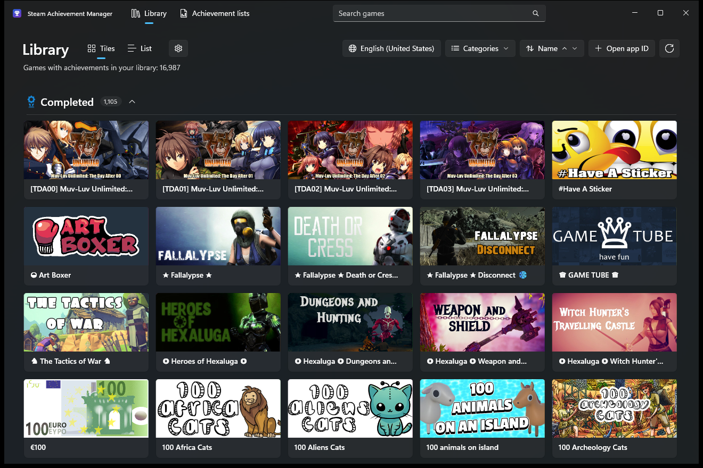
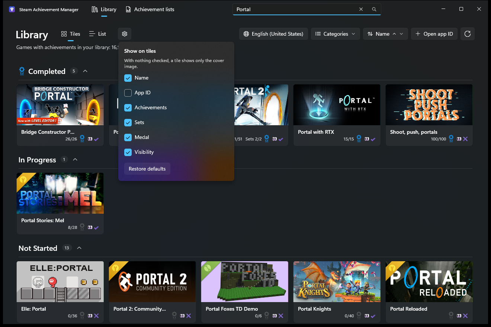
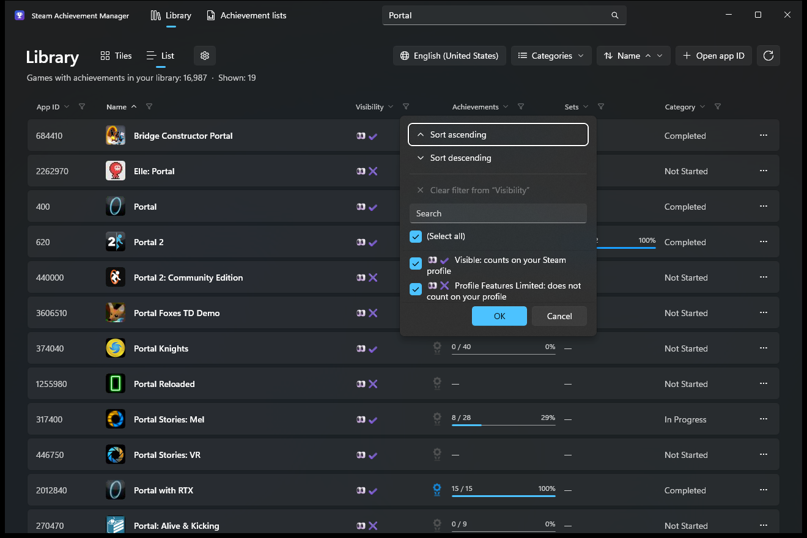
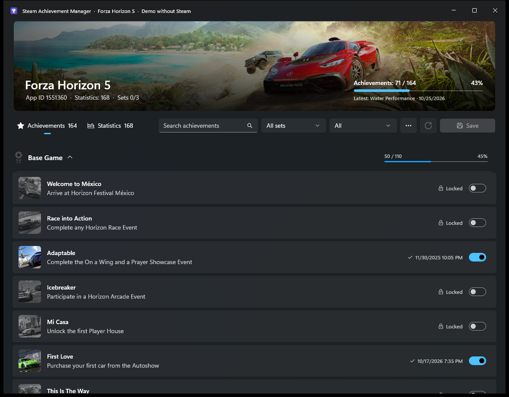
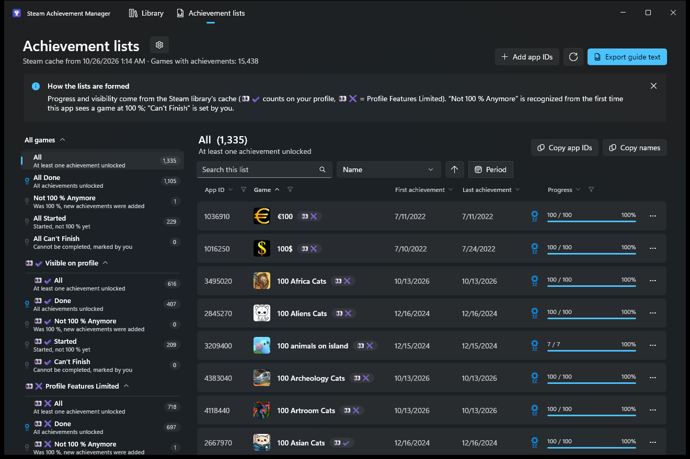
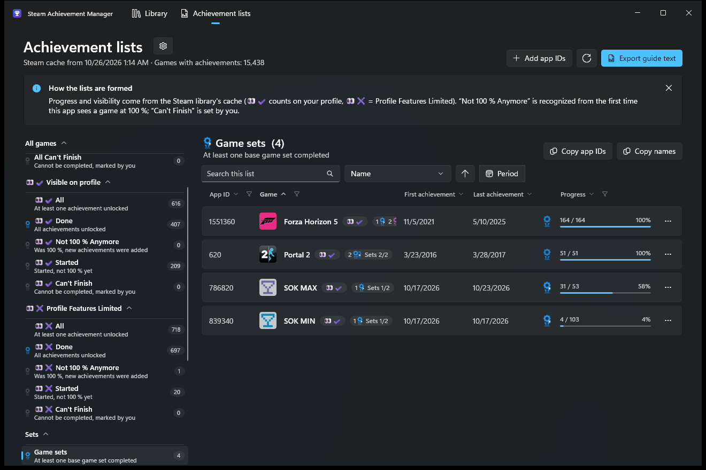
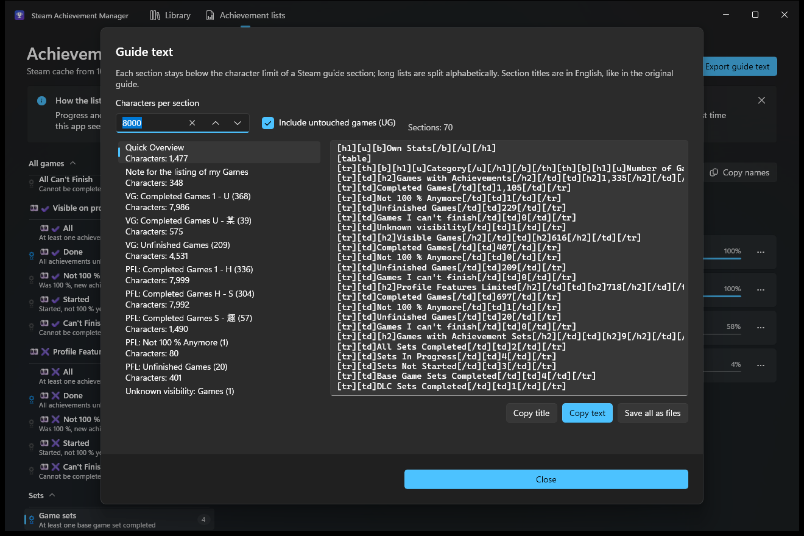

# Steam Achievement Manager – WinUI 3 version

A reworked version of the [Steam Achievement Manager](https://github.com/gibbed/SteamAchievementManager/)
by Rick "gibbed" as a modern Windows 11 app (WinUI 3, .NET 10, 64-bit).

> **Modified version.** This is not the original program. It is based on
> gibbed/SteamAchievementManager as of 2026-03-19 (commit `de8b710`, version 7.0) under the zlib license
> (see `LICENSE.txt`). The Steam interop and the logic for reading achievements come from the
> original; the user interface and the changes described below are new.

> **Made with Claude.** This version was developed by [justxanderscode](https://github.com/justxanderscode)
> together with [Claude](https://claude.com/claude-code), Anthropic's AI model, working in Claude Code: Claude wrote
> most of the code, the translations and this documentation, justxanderscode set the direction, tested against a
> real Steam library and decided what goes in. The translations other than English and German have not been
> reviewed by native speakers yet.

The original project lives at **[gibbed/SteamAchievementManager](https://github.com/gibbed/SteamAchievementManager)** –
please report problems with this version here, not there. An upstream pull request with this app is open as
[gibbed/SteamAchievementManager#649](https://github.com/gibbed/SteamAchievementManager/pull/649).

## Download

Get the latest ZIP from [Releases](../../releases/latest), extract it and start `SAM.exe`
(Windows 10 2004 or later / Windows 11, x64; Steam must be running and signed in). Always keep the whole folder
together – `SAM.exe` is a small launcher for `app\SAM.exe`.

## What the app does

Everything the original does – in a new look:

- **Library** (formerly `SAM.Picker`): all games of your account that have achievements – as tiles with cover
  images or as a list (switch "Tiles | List" next to the title, the choice is saved), search, filter
  "Categories" (Completed, In Progress, Not Started; inside it the "Game type" submenu with games, demos,
  mods and other – all checked – and the "Split into categories" switch for the sections),
  sorting by name, app ID, progress, sets, category or visibility, ascending or descending (saved),
  open a game by app ID, context menu (store page, show in Steam, copy app ID).
  The **list** shows per game the app ID, icon and name, profile visibility (👀✔/👀✖/👀? from Steam's achievement
  cache), medal, achievements ("21 / 57" with a bar), sets ("1 / 3" with a set icon and bar) and the category
  (Completed, In Progress, Not Started); a click opens the game, "…" shows the same menu as a right-click.
  **Column headers** work like in Excel: a click sorts (∧ ascending, ∨ descending, a second click reverses),
  the funnel opens sorting and filtering with a search and a checkbox per value ("(Select all)", "Clear filter
  from …"). The values in the filter are those that occur under the other filters; for achievements the
  percentage counts. Column filters only apply in the list view and are not saved in the settings. The **gear**
  next to "Tiles | List" shows and hides the columns in the list and arranges them (arrows or drag); order and
  selection are stored in `settings.json` (`libraryColumnOrder`, `libraryHiddenColumns`), "Restore defaults"
  resets them. Games without a value (no achievement count, no sets) are always at the end when sorting.
- **Game window** (formerly `SAM.Game`): unlock and lock achievements, edit statistics,
  reset everything – with a header image, progress display, search and filter.

New compared with the original:

- Mica background, custom title bar, light and dark theme following the Windows setting.
- Changes are kept while filtering and are marked; a counter on the Save button shows
  what has not been written to Steam yet.
- A summary before saving (what will be unlocked, locked, changed).
- "Unlock/lock/invert all shown" skips protected achievements instead of showing a message for each one.
- A warning when closing or reloading with unsaved changes.
- Resetting in one dialog with an explicit confirmation (instead of three prompts).
- Hidden achievements are marked; statistics show their type, value range and protection.
- The game list and images are cached (`%LOCALAPPDATA%\SteamAchievementManager`);
  if gib.me is unreachable, the last offline copy is used.
- Keyboard: `Ctrl+F` search, `F5` reload, `Ctrl+S` save.
- 72 language and country variants (since 1.1.0), see below.
- Achievement lists following the scheme of the Steam collections ("All" to "👀✖ Can't Finish") with export as
  Steam guide text (since 1.2.0), with the dates of the first and last achievement, icons, sorting,
  period filter and manually added app IDs (since 1.3.0), see below.
- Steam's achievement sets and medals for completed games and sets (since 1.4.0), see below.
- Library in sections Completed / In Progress / Not Started, each collapsible or switched off entirely
  (1.5.0, 1.7.0, 1.10.0).
- Sorting by progress, sets, category and visibility, each ascending or descending (1.6.0, 1.9.0).
- List view of the library with app ID, icon, name, visibility, medal, achievements and sets (with bars) and
  category (1.8.0); column headers like in Excel: sort, filter, show/hide and arrange columns (1.9.0).
- Tiles with achievement count, "Sets 1/3", medal and visibility – each selectable via the gear, on first start
  only cover and name (1.8.0, 1.10.0, 1.13.1).
- Achievement lists in the same window instead of a second one (switch in the title bar, 1.10.0), with
  group headings, collapsible, a medal per category, untouched games by visibility, game and DLC sets
  (1.10.0, 1.12.0, 1.13.0) and the app ID as a column of its own (1.13.0).
- Medals like on Steam: blue for one base game set, the blue double medal for several, the purple
  double medal for DLC, shown separately with counts; shine and sparkles animated (1.11.0).
- Guide text in Steam's markup: tables, headings, numbered lists (1.11.0).
- Collapsible sets in the game window (1.8.0).
- Program folder with only `SAM.exe` and the `app` folder (1.6.0).

## Screenshots

English user interface (Windows language English/United States); game window in the demo mode of the debug build.

| | |
|---|---|
|  |  |
| Library – tiles on first start (cover and name only) | Gear: what a tile shows |
|  |  |
| List view with Excel-like filter | Game window with achievement sets |
|  |  |
| Achievement lists | Game sets with medals like on Steam |
|  | |
| Guide text in Steam's markup | |

## Achievement lists

The switch **Library | Achievement lists** in the title bar changes, in the same window, to a view that sorts
all games with achievements into the
15 categories of the Steam collections from the guide
[Steam Achievement Statistics](https://steamcommunity.com/sharedfiles/filedetails/?id=3128095897):

| | All games | 👀✔ visible on profile | 👀✖ Profile Features Limited |
|---|---|---|---|
| at least one achievement | All | 👀✔ All | 👀✖ All |
| 100 % | All Done | 👀✔ Done | 👀✖ Done |
| was 100 %, new achievements were added | Not 100 % Anymore | 👀✔ Not 100 % Anymore | 👀✖ Not 100 % Anymore |
| started | All Started | 👀✔ Started | 👀✖ Started |
| cannot be completed | All Can't Finish | 👀✔ Can't Finish | 👀✖ Can't Finish |

The list on the left has its own heading per group (All games, Visible on profile, Profile Features Limited, Sets,
Not in the collections); a click on a heading collapses (∨) or expands (∧) the group, saved in
`settings.json` (`listsCollapsedGroups`). Every category carries its medal: Done the large blue one, Sets
"Completed" the blue double medal, "Game sets" the blue one, "DLC sets" the purple one, everything open (Not 100 %
Anymore, Started, Can't Finish, sets in progress/not started, untouched) the grey one; "All" is mixed and
has none. Under "Sets" come first **Game sets** (at least one base game set completed) and
**DLC sets** (at least one DLC set completed), then Completed, In Progress and Not Started. Under "Not in the
collections" are "Untouched games" (no achievement yet) and "👀✔ Untouched games" and "👀✖ Untouched games" by
visibility. The category names of the collections stay English in every language,
so that they match the collections; since 1.3.0 the app no longer shows the medal and number of the
collections (`🎖️ 1.0.1 …`).

**Where the data comes from:** from the cache the Steam library creates itself
(`<Steam>\userdata\<account>\config\librarycache\achievement_progress.json`). For every game it contains the
unlocked and total achievements and the field `vetted` – `true` means the game counts on the profile
(👀✔), `false` means Profile Features Limited (👀✖). **No game is launched and nothing is written to
Steam**; the app only checks ownership and names through the running Steam session.

**Classification** (every game is in exactly one subcategory, "All" combines all except the untouched ones):

1. **Done** – all achievements unlocked.
2. **Can't Finish** – marked by you, with an optional reason that appears in brackets in the guide text.
3. **Not 100 % Anymore** – the app has seen the game at 100 % before and now achievements are missing
   (Steam added new ones), or you marked it by hand. The cache has no history;
   so from the first start the app remembers which games were at 100 %
   (`%LOCALAPPDATA%\SteamAchievementManager\lists-<account>.json`, with a `.bak`).
   100 % that were lost earlier can be added via the "…" menu.
4. **Started** – at least one achievement, but not 100 %.

Games whose visibility Steam has not reported yet only appear in the "All games" categories.

**Every row** shows the app ID (a column of its own before icon and name, selectable), icon, name and visibility ("👀✔"),
plus the date of the **first** and the **last** unlocked achievement, the medal and the progress. The data comes from Steam's
stats files (`<Steam>\appcache\stats\UserGameStats_<account>_<app ID>.bin`,
`cache/<stat>/AchievementTimes`), the icons from `<Steam>\appcache\librarycache\<app ID>\` (otherwise from the
CDN). The stats file only exists for games whose achievements Steam has already loaded on this PC; the
others show "—". In the first test, 1,156 of 1,263 started games had data.

**Sorting** by name, app ID, first or last achievement or progress, ascending or descending (games without a
date are at the end) – via the selection or by clicking a column header (∧/∨). The column headers
filter like in the library (dates by year, progress by percentage), the gear next to the title
"Achievement lists" shows, hides and arranges columns (`listsColumnOrder`, `listsHiddenColumns`; a
new column such as the app ID is placed at its default position even in a saved order). Visibility and sets
stay badges after the name. **Period**: from–to, based on either the first or the last achievement; while it is set,
games without a date are hidden and the heading shows the number of games shown. Copying
app IDs and names follows search, period and order.

**Add app IDs** takes in games the lists do not pick up on their own – because they are not in Steam's
achievement cache or Steam does not report them as owned (e.g. Family Sharing). Input: one or
more app IDs or store links. If the game is missing from the cache, progress and dates come from Steam's stats
and schema files on this PC; visibility is then unknown (👀?). Such games carry the
note "Added manually" and can be removed again via the "…" menu. This is saved in
the file of the markings (`ManualApps`).

**Export guide text** builds the sections like the original guide and with Steam's formatting (BBCode):
"Quick Overview" as a table ("Own Stats": `[h1]` heading, `[table]` with `[h2]` rows for all games, visible
games, Profile Features Limited, sets and untouched games, below it `[hr]` and the date), "Note for the listing of my
Games" with the legend VG/PFL/UG, then "VG: Completed Games (365)", "PFL: Unfinished Games (9)" etc. as numbered
lists (`[olist]`, one `[*]` per game) and optionally "Untouched Games: Quick Overview" (a table of all UG sections) with
"UG: A (309)" etc. Numbers use a comma like in the original ("11,733"). Every section stays, including markup, below the
adjustable character limit (default 8,000); lists that are too long
are split alphabetically ("UG: Sa - Si"). Sorting ignores leading special characters and accents,
so "[TDA00] Muv-Luv" is listed under T. Sections can be copied one by one or all saved as text files
under `Documents\Steam Achievement Manager\Guide <date>`. Empty sections are left out.

## Achievement sets and medals

Since 2026-10-16 Steam has been testing **achievement sets** (beta): developers split the achievements of a game into
sets – base game sets (blue on Steam) and DLC sets (purple). A completed set
stays completed even if achievements are added later; **archived** achievements (can no longer be unlocked)
count neither for their set nor for the game, and DLC sets only count if the account owns the DLC.

SAM reads the sets from Steam's schema (`appcache\stats\UserGameStatsSchema_<app ID>.bin`: `groups/<n>/name`,
`dlcappid`, `order`; per achievement `groupid` and `archived`). Achievements without `groupid` form the "base game" set.
The schema already contains the sets without the Steam client beta; new sets arrive as soon as Steam refreshes
a game's schema.

- **Game window:** achievements grouped by set, per set the medal, name, "DLC" and progress (blue/purple),
  selection "All sets" or one set, the marker "Archived". The overall progress follows Steam's new rules
  (for Team Fortress 2 that is 516 instead of 520 achievements), at the top it says "Sets 2/16". A click on the header collapses (∨)
  or expands (∧) a set; "Unlock all shown" etc. then only affect the visible achievements.
- **Lists:** medal and "Sets 1/3" per game (tooltip with all sets), before that, like in Steam's header, the
  completed sets with a count: "1" + blue medal for the base game (from two sets on the blue double medal),
  "2" + purple double medal for DLC – Steam always shows DLC as double. The same in the "Sets" column
  of the library list and at the top of the game window, as long as the game is not fully completed. Under the heading "Sets"
  are the games with sets by their state, deliberately not split by visibility, each with the purple
  set icon: "Completed" (all sets that count are done), "In Progress", "Not Started". Below that
  follows "Not in the collections" with the untouched games (all, 👀✔, 👀✖).
  "Done" follows Steam's rules if the
  schema matches Steam's achievement cache; the app remembers completed sets like Steam does (`CompletedSets` in the
  file of the markings). The unlock state per achievement comes from the bit field in `UserGameStats_…bin`.
- **Library:** three sections "Completed", "In Progress" and "Not Started" (each can be unchecked in the
  "Categories" filter). A click on the heading collapses (∨) or expands (∧) the section;
  the number of games stays visible, and which sections are collapsed is remembered in
  `%LOCALAPPDATA%\SteamAchievementManager\settings.json` (`collapsedSections`). Under the name, next to the
  app ID, there is the number of achievements ("164/164") and for games with sets "Sets 1/3"; if space gets tight, the
  app ID is trimmed. Tiles of completed games carry the large medal at the bottom right. Games in progress and games not
  started carry the grey medal (tooltip: section and "Achievements: 21 / 57") – unless a set is already
  completed, then the tile shows its blue or purple medal. The **gear** next to "Tiles | List"
  decides what a tile shows: name, app ID, achievements, sets, medal and visibility (👀✔/👀✖, on the far right
  after the medal) – on first start only the name;
  with nothing checked only the cover image remains (`tileHiddenParts` in `settings.json`). "Split into categories" in the
  "Categories" menu switches the three sections off (`libraryGrouped`).
  Which schemas contain sets is remembered in `%LOCALAPPDATA%\SteamAchievementManager\sets-index.json`
  (only changed files are searched again).

**Medals** (`SAM.App/Assets/Medals`, generated with `python tools/make-medals.py "<folder>"` from the animated
source SVGs, which are not part of the repository): large blue = game completed (`medal-large-blue.svg`), blue = one
base game set (`medal-blue.svg`), blue double medal = several base game sets (`medal-blue-double.svg`), purple
double medal = DLC sets (`medal-purple-double.svg`), grey = still open (`medal-unfinished.svg`).

**Animation:** the colored medals shine and sparkle like on Steam's pages. `python tools/make-medal-frames.py
"<folder>"` renders the original SVGs with Microsoft Edge (headless) at fixed points in time (4 s, 25 frames/s; the
animations are paused via the Web Animations API, so the staggered sparkles are right too) and writes one
image strip per medal to `Assets/Medals/Animated/` and the points in time to `Helpers/MedalAnimations.g.cs`. In the app,
`MedalView` moves the strip via Composition (runs on the GPU); the sparkles may extend beyond the edge of the
medal. If "Animation effects" is off in Windows, the app shows the calm version. The Windows SVG renderer supports neither CSS
nor filters or masks; so the script removes animation, shine and sparkles (the app shows the calm
initial state), bakes the dimming into the colors and cuts off the margin for the sparkles. It rebuilds the mask of the
purple medal (the gap between the two medals) as a cut-out: rasterize the front medal, grow it by
half the stroke width, trace the outline back (opencv-python), insert it as a `clip-path` with `evenodd`.

## Languages

The app follows the Windows display language. The globe button in the library picks one
of the 72 variants permanently; the app then restarts. The list starts with the Windows setting and the
variant that matches the Windows language ("system language"), then all others by tag (ar-AE, ar-EG, …). A chosen variant also sets date
and number formats (e.g. `15’345` in Switzerland, Hijri calendar in Saudi Arabia).
The names and descriptions of the achievements themselves come from Steam in the language of the Steam client.

| Translation | Variants |
|---|---|
| German | de-DE, de-AT · Swiss spelling (ss, «»): de-CH, de-LI |
| English | en-GB, en-IE, en-US, en-CA, en-AU, en-NZ, en-IN, en-PH, en-SG, en-ZA |
| Spanish | es-ES, es-MX, es-AR, es-CL, es-CO, es-PE, es-VE, es-UY |
| Portuguese | pt-PT (European), pt-BR (Brazilian) – separate translations |
| Chinese | zh-CN (Simplified), zh-TW and zh-HK (Traditional) |
| Serbian | sr-RS (Cyrillic), sr-ME (Latin) |
| Arabic, Hebrew | ar-AE, ar-SA, ar-EG, he-IL – right-to-left user interface |
| one variant each | lb-LU, nl-BE/nl-NL, fr-FR, it-IT, da-DK, sv-SE, nb-NO, fi-FI, is-IS, pl-PL, cs-CZ, sk-SK, hu-HU, sl-SI, hr-HR, bs-BA, mk-MK, sq-AL, el-GR/el-CY, bg-BG, ro-RO/ro-MD, uk-UA, be-BY, et-EE, lv-LV, lt-LT, mt-MT, tr-TR, ru-RU, ja-JP, ko-KR, id-ID, th-TH, vi-VN, ms-MY |

Other Windows languages fall back to English.

The texts are JSON files in `SAM.App/Strings/` (one file per translation, embedded in the EXE).
After changes run `python tools/strings.py`: it checks all files against `en.json`
(missing keys, placeholders such as `{0}`), generates `de-CH.json` from `de.json` and `sr-Cyrl.json`
from `sr-Latn.json` and writes the C# accessors `SAM.App/Localization/Strings.g.cs`.
So add new texts to `en.json` first, then to all other files.

Counts are deliberately phrased as "Achievements: 21 / 57" instead of "21 achievements" – that way no
language needs plural rules (Polish, Russian or Arabic would have up to six forms).

## Usage

1. Start Steam and sign in.
2. Start `SAM.exe` – the library appears.

   The program folder contains only `SAM.exe`, `README.md`, `LICENSE.txt` and the `app` folder. `SAM.exe` is a
   small launcher that starts `app\SAM.exe`; that is where the actual program lives, with .NET, the Windows App SDK and
   the language folders (`de-DE`, `fr-FR`, …). These language folders belong to WinUI itself – Windows only looks for them
   directly next to `Microsoft.UI.Xaml.dll`; in a folder of their own ("lang") the program does not start. Always copy the
   folder completely; the settings are stored separately in `%LOCALAPPDATA%\SteamAchievementManager`.

3. Click a game: it opens in a window of its own (its own process, like in the original).
   `SAM.exe <app ID>` opens a game directly.

**Note:** while a game window is open, Steam shows you as "in game". If the same
account is used to play somewhere else at the same time (another PC, Steam Deck, ASF idler), Steam may end the
session – this applies to the original as well.

## Technical changes to the Steam interop (`SAM.API`)

The original is a 32-bit program. For 64-bit, these fixes were necessary:

| Place | Problem under 64-bit | Fix |
|---|---|---|
| `Steam.GetInstallPath` | 64-bit processes don't see the `WOW6432Node` key | 32-bit view, native view, then `HKCU\…\SteamPath` |
| `Steam.Load` | loaded `steamclient.dll` | loads `steamclient64.dll` in a 64-bit process |
| `CallbackMessage` and others | `Pack = 1` – Steam packs callbacks with 8 bytes; the structure would be 4 bytes too small | `Pack = 8` |
| `GetISteamApps` | call without the object pointer (only worked by chance under 32-bit) | `this` pointer and `ThisCall` added |
| `AppDataChanged.Result` | `bool` was read as a 4-byte `BOOL` | `MarshalAs(I1)` |
| `NativeWrapper.ToString` | `ToInt32()` on 64-bit pointers | `ToInt64()` |

In addition: the CDN `shared.cloudflare.steamstatic.com` now redirects to `shared.steamstatic.com`,
which is used directly.

## Layout

```
SAM.API/            Steam interop from the original, ported to .NET 10 / x64
SAM.App/            WinUI 3 app (one SAM.exe for library and game window), in the release under app/
SAM.Launcher/       launcher SAM.exe in the program folder (.NET Framework 4.8, starts app\SAM.exe with the same arguments)
  Views/            LibraryWindow (library), GameWindow (achievements & statistics), ListsPage (lists, inside the library window)
  Schema/           KeyValue reader and stat definitions from SAM.Game (unchanged)
  Game/, Library/   list entries with change state
  Columns/          list columns: order/selection (ColumnLayout), ColumnsPanel, column headers, filter and column menus
  Lists/            read the achievement cache, unlock times and achievement sets, build categories, save markings, create guide text
  Assets/Medals/    medals (static SVGs from tools/make-medals.py, animation strips from tools/make-medal-frames.py)
  Steam/            connection, callback pump, image addresses
  Helpers/          title bar, dialogs, image cache, settings, medals
  Localization/     language choice (AppLanguage), text access (Strings)
  Strings/          translations as JSON
tools/              make-icons.py (app icon), make-medals.py (medals), make-medal-frames.py (medal animation), strings.py (translations), archive-version.py (version archive)
```

## Building

Requirement: .NET 10 SDK (the Windows App SDK comes via NuGet).

```bash
dotnet build SAM.App/SAM.App.csproj -c Debug -p:Platform=x64
dotnet publish SAM.App/SAM.App.csproj -c Release -r win-x64 -p:Platform=x64
```

The published program is self-contained (includes .NET and the Windows App SDK) and runs on
Windows 10 2004 or later on x64 (on ARM64 through x64 emulation, because Steam only offers x86/x64).
The finished program folder (launcher + `app/`) is built by `python tools/archive-version.py <version> "text"`;
the version is set in `SAM.App.csproj`, `SAM.API.csproj` and `SAM.Launcher.csproj`.

Debug build only: `SAM.exe --demo <app ID>` (as the first argument) shows the game window with the locally cached
schema and made-up states, without connecting to Steam – for checking the user interface.
`SAM_THEME=light` or `dark` forces a theme. `--language <locale>` starts once in a
language without saving the setting; `--dump-languages <file>` writes the mapping of all
72 variants to their translations. `--medals` shows all medals in several sizes on light and dark
backgrounds.

## License and origin

- Steam Achievement Manager © 2024 Rick (gibbed), zlib license – see `LICENSE.txt` and `SAM.API/LICENSE.txt`.
- This version is modified (see above) and is not the original.
- The app icon (trophy) is newly drawn (`tools/make-icons.py`).

## Credits

- **Rick "gibbed"** – the original Steam Achievement Manager, its Steam interop and schema reader.
- **justxanderscode** – this WinUI 3 version: idea, direction, testing.
- **Claude** (Anthropic, via [Claude Code](https://claude.com/claude-code)) – co-author of this version: code,
  translations and documentation. Commits carry a `Co-Authored-By: Claude` line.
- Category scheme of the achievement lists after the guide
  [Steam Achievement Statistics](https://steamcommunity.com/sharedfiles/filedetails/?id=3128095897).
